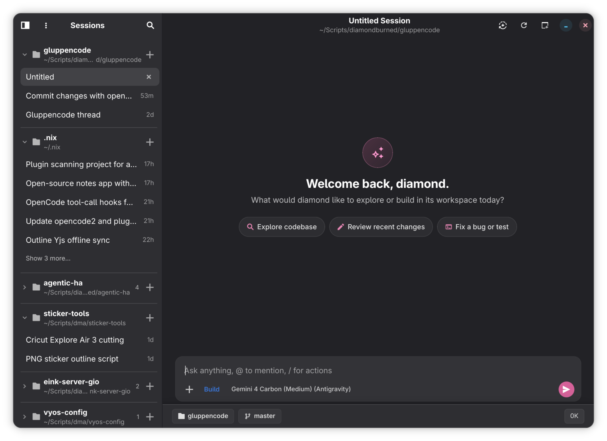

  <h1>gluppencode</h1>
  

Vibe-coded Go + GTK4 frontend for Opencode. My daily driver harness frontend at this point. Created using gotk4 (which I made by hand, with love. Mostly!)

## Why?

GTK4 is fast! The terminal, within Zellij, is slow. At one point, I was having >12 tabs open all at once just to juggle the common workflow of “editor + opencode + daemon”.

At the same time, I was getting used to Antigravity Hub at work, which featured a left-handed sidebar listing your most recent conversations. This isn’t a rare pattern either: Claude has it, and ChatGPT has had it since the beginning, so I figured why not?

## Feature Requests

I’m quite receptive to new features if it helps covering missing surfaces that opencode’s TUI has. For example, missing commands, additional settings, etc.

For features that opencode doesn’t actually have (such as the “Take Charge” feature), I’m less receptive, but PRs are still welcome either way. The codebase is vibed, so just make sure it’s not completely garbage code and you’ll be fine.
